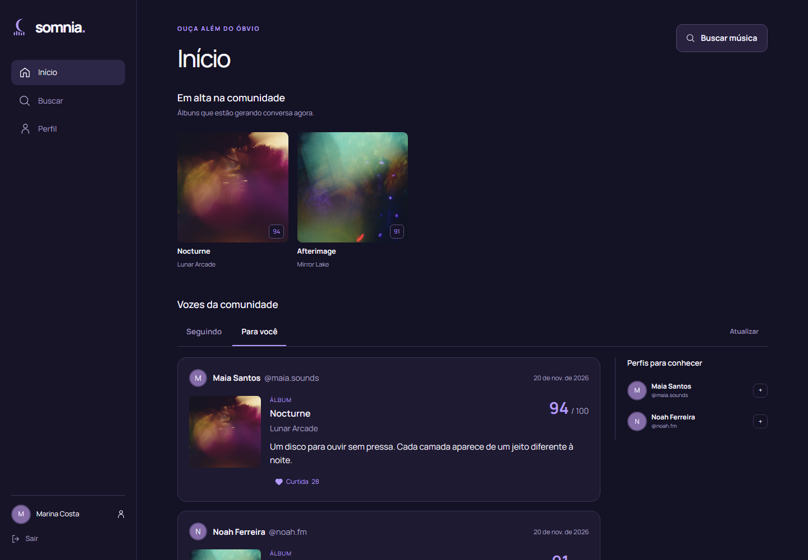
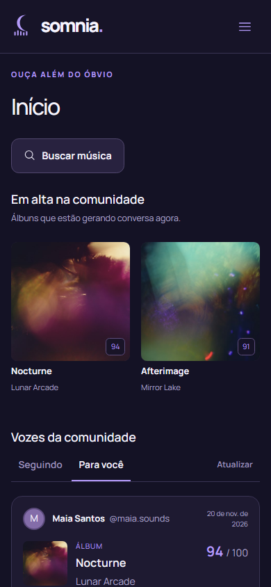
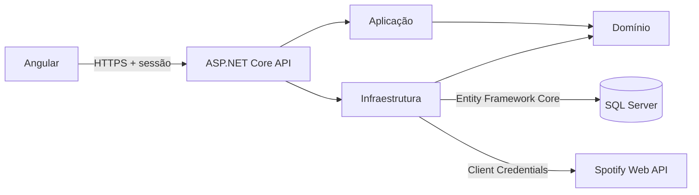

<div align="center">

# ✦ Somnia

### Música também se vive através do que ela desperta.

Descubra álbuns e faixas, escreva avaliações e encontre pessoas que sentem a música como você.

<br />


<br />

[O projeto](#-o-projeto) · [Funcionalidades](#-funcionalidades) · [Como executar](#-como-executar) · [Arquitetura](#-arquitetura) · [API](#-api)

</div>

---

## 🌙 O projeto

**Somnia** é uma aplicação social para registrar e compartilhar avaliações musicais. Cada pessoa pode explorar o catálogo, avaliar álbuns ou faixas e acompanhar o que a comunidade está ouvindo e comentando.

O projeto combina uma interface responsiva em Angular com uma API em ASP.NET Core. A API integra o catálogo do Spotify e armazena contas, avaliações e relações entre participantes em SQL Server.

> Um espaço para guardar o que a música fez você sentir.

### A experiência atual

Capturas da área de descoberta e do feed, no desktop e no celular:

<p align="center">
  
  &nbsp;&nbsp;
  
</p>

## ✨ Funcionalidades

| Recurso | O que você pode fazer |
| --- | --- |
| 🔐 Conta e sessão | Criar conta, entrar, renovar a sessão e sair de todos os dispositivos. |
| 🎧 Catálogo musical | Pesquisar álbuns e faixas e consultar seus detalhes pelo catálogo do Spotify. |
| ✍️ Avaliações | Escrever, editar e excluir uma avaliação de álbum ou faixa, com nota opcional e resenha. |
| 📊 Notas da comunidade | Consultar a média e a quantidade de notas dadas a cada item. |
| 💜 Curtidas | Curtir ou remover a curtida de uma avaliação e ver a contagem e o próprio estado. |
| 📰 Feed e descoberta | Ver avaliações de quem você segue ou explorar avaliações e perfis sugeridos. |
| 👥 Relações | Seguir participantes e consultar listas de seguidores e pessoas seguidas. |
| 👤 Perfis | Editar nome, biografia e avatar e consultar o histórico de avaliações. |
| 📲 Compartilhamento | Compartilhar suas próprias avaliações como imagem vertical, usando o menu de compartilhamento do navegador ou baixando a imagem. |
| 📱 Interface responsiva | Usar as telas de autenticação, catálogo, feed e perfil em dispositivos móveis e desktop. |

O compartilhamento direto para Stories por integração nativa com aplicativos fica para uma etapa posterior ao MVP.

### Um passeio pelo aplicativo

1. **Crie sua conta** e personalize seu perfil.
2. **Pesquise uma faixa ou álbum** no catálogo musical.
3. **Escreva uma avaliação** com uma nota, uma resenha ou os dois.
4. **Explore o feed**, descubra outras avaliações e siga participantes.
5. **Curta e compartilhe** avaliações para interagir com a comunidade.

## 🧰 Tecnologias

| Camada | Tecnologias e responsabilidades |
| --- | --- |
| Interface | **Angular 22**, **TypeScript 6**, componentes standalone, Signals e Reactive Forms. |
| Estilos e ícones | **Tailwind CSS 4**, SCSS e **Lucide Angular**. |
| API | **ASP.NET Core 10**, controllers REST, autenticação e documentação OpenAPI/Swagger. |
| Aplicação e domínio | Casos de uso com **MediatR**, regras de negócio e contratos. |
| Persistência | **Entity Framework Core 10**, migrations e **SQL Server**. |
| Catálogo | Spotify Web API com Client Credentials. |
| Testes | **xUnit** no backend e **Vitest/Playwright** no frontend. |

As versões refletem os manifests do repositório. O deploy e a homologação completa do MVP ainda estão pendentes; veja [Preparação do piloto](docs/PILOTO.md).

## 🚀 Como executar

### Pré-requisitos

- **Git**.
- **SDK do .NET 10**.
- **Node.js 24.15.x** e **npm 11.19.x**.
- Uma instância local ou acessível de **SQL Server**.
- Credenciais de aplicativo do **Spotify** para habilitar a busca real do catálogo.

Os comandos a seguir partem da raiz do repositório e usam PowerShell.

### 1. Clone o repositório

```powershell
git clone https://github.com/k-silvax19/Somnia.git
cd Somnia
```

### 2. Configure a API

Guarde connection string, chave JWT e credenciais Spotify em User Secrets. Use valores próprios para o seu ambiente; a chave JWT precisa ter pelo menos 32 bytes.

```powershell
dotnet user-secrets set "ConnectionStrings:SqlServer" "<conexão SQL Server local>" --project server/src/Api
dotnet user-secrets set "Jwt:SigningKey" "<chave aleatória com pelo menos 32 bytes>" --project server/src/Api
dotnet user-secrets set "Spotify:ClientId" "<Client ID do Spotify>" --project server/src/Api
dotnet user-secrets set "Spotify:ClientSecret" "<Client Secret do Spotify>" --project server/src/Api
dotnet dev-certs https --trust
```

`Jwt:Issuer` e `Jwt:Audience` já têm valores de desenvolvimento em `server/src/Api/appsettings.json`. Para uma instância local diferente, ajuste `Cors:AllowedOrigins` para incluir a origem HTTPS do frontend. Não coloque credenciais em arquivos versionados.

Restaure e inicie a API:

```powershell
dotnet restore server/Somnia.slnx
dotnet run --project server/src/Api --launch-profile https
```

O perfil local usa `https://localhost:7201` e redireciona HTTP em `http://localhost:5094` para HTTPS. Em `Development`, as migrations são aplicadas ao iniciar.

| Serviço | Endereço local |
| --- | --- |
| API | `https://localhost:7201` |
| Swagger UI | `https://localhost:7201/swagger` |
| OpenAPI | `https://localhost:7201/openapi/v1.json` |

Swagger e OpenAPI ficam disponíveis apenas em `Development`. O appsettings base deixa o catálogo desativado; em desenvolvimento, `appsettings.Development.json` habilita Spotify. Consulte [Catálogo musical](server/CATALOGO.md) para configuração e limites.

### 3. Inicie o frontend

Em outro terminal:

```powershell
cd client
npm ci
npm start
```

Abra **https://localhost:4200**. O script prepara o certificado HTTPS local do Angular. A API local já permite essa origem. Use `localhost` no navegador para corresponder ao certificado.

Para conferir as opções adicionais de execução e os testes de navegador, consulte [client/README.md](client/README.md).

## 🏗️ Arquitetura

O backend separa entrada HTTP, casos de uso, domínio e persistência. O frontend Angular consome a API por HTTPS.



| Projeto | Responsabilidade |
| --- | --- |
| **Api** | Controllers, contratos HTTP, autenticação, CORS, rate limiting e OpenAPI. |
| **Aplicacao** | Comandos, consultas, handlers e coordenação dos casos de uso. |
| **Dominio** | Entidades, regras, tipos e contratos do domínio. |
| **Infraestrutura** | SQL Server, EF Core, Identity, repositórios e integração com o catálogo. |
| **Worker** | Host legado RabbitMQ/MassTransit, mantido para concluir mensagens de avatar publicadas por versões anteriores. |

### Estrutura do repositório

```text
Somnia/
├── client/
│   ├── docs/                 # Capturas de tela
│   ├── public/               # Recursos públicos do frontend
│   └── src/app/              # Funcionalidades e componentes Angular
├── docs/                     # Produto, piloto e decisões de funcionalidades
├── server/
│   ├── src/
│   │   ├── Api/
│   │   ├── Aplicacao/
│   │   ├── Dominio/
│   │   ├── Infraestrutura/
│   │   └── Worker/
│   └── tests/Somnia.Tests/
└── README.md
```

## 🔌 API

As rotas da tabela são relativas a `https://localhost:7201`. A API exige autenticação nas rotas protegidas. O login web usa cookies seguros para refresh e CSRF; o Swagger local está configurado para enviar os cabeçalhos necessários.

| Método | Rota | Operação |
| --- | --- | --- |
| `POST` | `/api/auth/register` | Criar conta. |
| `POST` | `/api/auth/login` | Iniciar sessão. |
| `POST` | `/api/auth/refresh` | Renovar a sessão. |
| `POST` | `/api/auth/logout` | Encerrar sessões da conta. |
| `GET` | `/api/me` | Consultar o perfil autenticado. |
| `PATCH` | `/api/me/profile` | Editar nome e biografia. |
| `GET` | `/api/users/{username}` | Consultar perfil. |
| `GET` | `/api/catalog/search` | Pesquisar álbuns ou faixas. |
| `GET` | `/api/catalog/albums/{externalId}` | Consultar detalhes de álbum. |
| `GET` | `/api/catalog/tracks/{externalId}` | Consultar detalhes de faixa. |
| `POST` | `/api/reviews` | Criar avaliação. |
| `GET` | `/api/reviews/{id}` | Consultar avaliação. |
| `PUT` | `/api/reviews/{id}` | Editar avaliação própria. |
| `DELETE` | `/api/reviews/{id}` | Excluir avaliação própria. |
| `PUT` / `DELETE` | `/api/reviews/{id}/like` | Curtir ou remover a curtida. |
| `GET` | `/api/users/{username}/reviews` | Consultar histórico de avaliações. |
| `GET` | `/api/feed` | Consultar o feed de quem segue. |
| `GET` | `/api/discover` | Explorar avaliações e sugestões. |
| `PUT` / `DELETE` | `/api/users/{username}/follow` | Seguir ou deixar de seguir. |
| `GET` | `/api/users/{username}/followers` | Listar seguidores. |
| `GET` | `/api/users/{username}/following` | Listar pessoas seguidas. |

Consulte o Swagger com a API local em execução ou os documentos em [`docs/`](docs/).

## 📐 Regras do produto

- Cada participante tem uma avaliação atual por item musical; álbum e faixa são itens separados.
- A nota é opcional e, quando informada, é um inteiro de **0 a 100**. Zero é uma nota válida.
- A resenha é opcional. Uma resenha sem nota não contribui para a média da comunidade.
- Somente o autor pode editar ou excluir sua avaliação. Os perfis e avaliações exigem autenticação.
- Participantes podem curtir avaliações, inclusive as próprias; a relação de curtida é única por pessoa e avaliação.
- O histórico do perfil lista avaliações atuais, sem registros repetidos de audição. Diário musical privado não faz parte do MVP.

## 🧪 Build e testes

Na raiz do repositório, para compilar e executar os testes unitários do backend:

```powershell
dotnet build server/Somnia.slnx -c Release
dotnet test server/tests/Somnia.Tests -c Release
```

No diretório `client`, os comandos de build, formatação, testes unitários e navegador são:

```powershell
npm run build
npm run format:check
npm test -- --watch=false
npx playwright install chromium
npm run test:e2e
```

Os testes de API que dependem de serviços locais descartáveis e os requisitos de execução estão descritos em [client/README.md](client/README.md), [Autenticação](docs/AUTENTICACAO.md) e [Mensageria](docs/MENSAGERIA.md).

## 📚 Documentação

- [Contexto e próximos passos](docs/CONTEXTO.md)
- [Preparação do piloto](docs/PILOTO.md)
- [Avaliações](docs/AVALIACOES.md) · [Curtidas](docs/CURTIDAS.md) · [Compartilhamento](docs/COMPARTILHAMENTO.MD)
- [Catálogo musical](docs/CATALOGO.md) · [Comunidade](docs/COMUNIDADE.md) · [Relações](docs/RELACOES.md)
- [Autenticação](docs/AUTENTICACAO.md) · [Perfis](docs/PERFIS.md) · [Mensageria](docs/MENSAGERIA.md)

---

<div align="center">

**Somnia — encontre as histórias que a música desperta.**

[Voltar ao topo](#-somnia)

</div>
